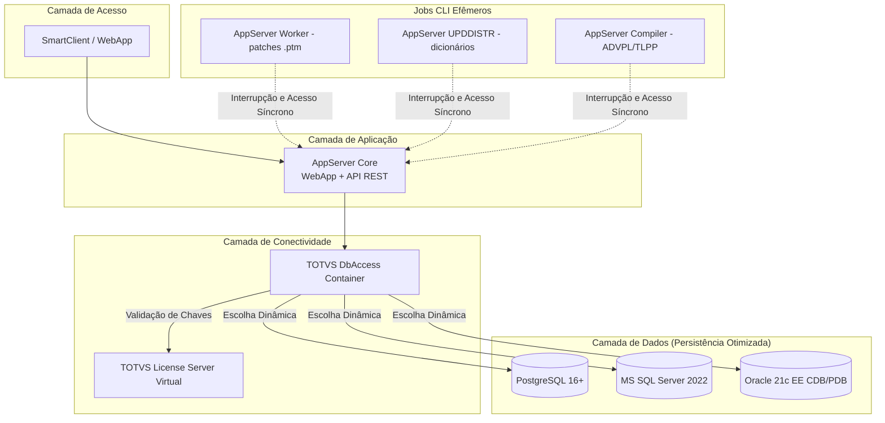

# TOTVS Protheus - Modern DevOps Ecosystem 🚀

Este repositório faz parte de uma iniciativa de modernização de infraestrutura para o ERP **TOTVS Protheus**, aplicando conceitos rigorosos de **DevOps, Conteinerização Avançada, Otimização de Performance e Arquitetura de Micro-serviços**.

O objetivo principal é criar um ambiente modular, escalável e 100% automatizado via Docker, substituindo instalações manuais e monolíticas por processos modernos de Infraestrutura como Código (IaC).

---

## 🏗️ Visão Geral da Arquitetura do Projeto

O ecossistema foi desenhado seguindo o princípio da **segregação de responsabilidades**. Cada componente essencial do Protheus opera de forma isolada, comunicando-se exclusivamente por meio de nomes de serviço (DNS interno do Docker), eliminando por completo o uso de IPs estáticos `hardcoded`.



## 🚀 Estrutura de diretórios do Projeto

```text
protheus-docker/
│
├── appserver/              # Camada de Aplicação (Core & Jobs)
│   ├── Dockerfile
│   ├── entrypoint.sh       # Boot: extração anti-loop e geração do appserver.ini por ROLE
│   ├── appserver.custom.ini # Overrides do appserver.ini (editável, mesclado no boot)
│   ├── ini_merge.awk       # Merge determinístico do override no .ini gerado
│   ├── generated/          # Espelho SÓ-LEITURA do .ini final, um por papel (gitignored)
│   ├── patch_deployer.sh   # Job worker: aplica patches .ptm com rollback do RPO
│   └── code_compiler.sh    # Job compiler: compila ADVPL/TLPP com rollback do RPO
│
├── databases/              # Camada de Dados (Motores de Persistência)
│   ├── postgres/
│   │   ├── Dockerfile
│   │   └── init-protheus.sh
│   ├── mssql/
│   │   ├── Dockerfile
│   │   └── init-protheus.sql
│   └── oracle/             # Stack de Persistência Multitenant Isolada
│       ├── Dockerfile
│       └── init-protheus.sh
│
├── license_server/         # Centralização de Licenciamento com SYS_RAWIO
│   ├── Dockerfile
│   ├── entrypoint.sh
│   └── install.exp         # Instalação não-assistida do IzPack (dirigida por expect)
│
├── dbaccess/               # Gateway de Dados (Preparado para OCI8 e ODBC)
│   ├── Dockerfile
│   ├── entrypoint.sh       # Geração dinâmica via dbaccesscfg e encriptação de senhas
│   └── dbaccess.ini.tmpl   # Referência do formato esperado (NÃO é consumido em runtime)
│
├── protheus/               # Artefatos locais do ERP (Mapeamentos de Volumes do Host)
│   ├── bin/                # Binários TOTVS (appserver.tar.gz / webapp.tar.gz)
│   ├── apo/                # Repositório de Objetos compilados (RPOs)
│   │   └── aporollback/    # Backup efêmero do RPO para rollback de contingência
│   ├── patches/            # Fila de entrada dos jobs worker e compiler
│   ├── system/             # menus.zip
│   ├── systemload/         # dicionarios.zip / diferencial.zip / help.zip
│   └── includes/
│       ├── advpl/includes.zip
│       ├── tlpp/includes.zip
│       └── custom/includes.zip   (opcional)
│
├── .env                    # Variáveis globais + DB_TYPE (seletor do SGBD). Não versionado
├── .env.postgres           # DB_TYPE/DB_SERVER/DB_PORT + credenciais root do PostgreSQL
├── .env.mssql              # idem, MS SQL Server
├── .env.oracle             # idem, Oracle 21c
├── .env.example            # Modelo do .env
├── .env.base.<nome>        # Uma base por arquivo (lab, lab2, dev): DB_NAME + core/volumes/porta
├── test-local.sh           # ProBat rápido contra o core que já está no ar
├── tools/advpl-lint/       # Analisador estático oficial da TOTVS (via Docker)
├── .gitignore              # Barreira contra vazamento de binários/RPOs/secrets
├── docker-compose.yaml     # Orquestrador parametrizado por Docker Profiles
├── run.sh                  # Interface única do ambiente (a suportada)
├── check-so.sh             # Confere o SO das imagens contra a lista homologada pela TOTVS
└── README.md               # Este arquivo
```

---

## ⚡ Status Atual do Projeto e Roadmap

* [x] **Fase 1: Camada de Dados Otimizada**

  * [x] Containerização do `PostgreSQL 16+` parametrizado com as LC_tags oficiais da TOTVS (`WIN1252`, `LC_COLLATE=C`).
  * [x] Containerização do `MS SQL Server 2022 Developer` com Collation Binária (`Latin1_General_BIN`).
  * [x] Containerização do `Oracle 21c Enterprise Edition` configurado nativamente com a trava de engine exigida `CURSOR_SHARING=EXACT`.
  * [x] Inicialização dinâmica de bancos de dados, usuários e permissões via variáveis de ambiente.
  * [x] Tuning inicial de performance de disco e memória para ambientes de desenvolvimento/homologação.

* [x] **Fase 2: Camada de Conectividade (dbAccess)**

  * [x] Dockerfile do License Server Virtual com instalação não-assistida do instalador Java (IzPack). O `install` do tarball da TOTVS ignora argumentos e não tem modo silencioso, então os prompts são dirigidos por `expect` ([license_server/install.exp](license_server/install.exp)). Injeção do `dmidecode` para a leitura do hardlock.
  * [x] Dockerfile do dbAccess inteligente preparado para multi-drivers (`Postgres/SQL Server/Oracle`).
  * [x] As três imagens partem de `oraclelinux:8`, o SO que o Protheus 12.1.2410 homologa (a tela "Finalizar" recusa Ubuntu). Conferível com `./check-so.sh`.
  * [x] Resiliência de inicialização com scripts de boot que realizam testes de socket TCP e aguardam a prontidão real dos SGBDs.
  * [x] Ordem de subida garantida por `healthcheck` + `depends_on: service_healthy` — `license_server` → `dbaccess` → `appserver_*`. O `service_started` padrão não bastaria: o socket demora a atender depois que o container "inicia", e um AppServer que suba nessa janela morre tentando conectar.
  * [x] Automação imperativa do `dbaccess.ini` direto na pasta de execução oficial (multi/), utilizando a ferramenta oficial `dbaccesscfg` para realizar a encriptação de senhas em `runtime`, eliminando dependências do `DBMonitor` gráfico.
  * [x] Orquestrador dinâmico global `run.sh` para chaveamento automático de infraestrutura.

* [x] **Fase 3: Camada de Aplicação Modular (AppServer)**

  * [x] Isolamento total de binários estáveis dentro da imagem, eliminando dependências externas do Host.
  * [x] Arquitetura de volumes totalmente apartada (Named Volumes), mitigando a poluição do Host com dicionários descompactados.
  * [x] Lógica de boot resiliente com extração inteligente e silenciosa (`-nq`) e travas anti-loop independentes por pacote (`.fiscal_boot_done`, `.menus_boot_done`).
  * [x] Tratamento dinâmico para espalhar os arquivos de menus diretamente na raiz do diretório `system`.
  * [x] Renderização dinâmica do arquivo `appserver.ini` em runtime na porta 1234, isolando as credenciais locais e respeitando o RPO Unificado (`tttm120.rpo`).
  * [x] AppServer único servindo o WebApp/SmartClient na porta multiprotocolo e a **API REST** numa porta HTTP dedicada, e `Docker Profiles` isolando os jobs CLI efêmeros (`worker`, `upddistr`, `compile`).

* [x] **Fase 4: Jobs CLI Síncronos**
  * [x] Jobs efêmeros que param os AppServers para liberar o lock do RPO, executam em foreground e religam exatamente os serviços que estavam ativos, propagando o exit code: `worker` (patches `.ptm`), `compile` (ADVPL/TLPP) e `upddistr` (dicionários).
  * [x] Backup preventivo do RPO e rollback automático em caso de falha.

* [ ] **Fase 5: Esteira GitOps (não implementada)**
  * [ ] Repositório de fontes ADVPL desacoplado da infraestrutura.
  * [ ] Workflow do GitHub Actions delegando a compilação a um `Self-Hosted Runner` no host — o `./run.sh <sgbd> compile` já está pronto e propaga o exit code, que é o que o runner leria.
  * [ ] Análise estática (SonarQube / TOTVS AppAnalyzer) como *quality gate* do PR.
  * [ ] Feedback do resultado da compilação como comentário automático no PR.

> **Nota de honestidade.** A Fase 5 é intenção, não realidade: **não há** `.github/workflows/` neste repositório, nenhum runner registrado, nenhum workflow jamais executado e nenhuma configuração de SonarQube. O que existe e está verificado é a metade de baixo da esteira — o `./run.sh <sgbd> compile`, que é justamente o comando que um runner invocaria.

---

## 🛠️ Tecnologias Utilizadas

* `Docker & Docker Compose` (Isolamento, volumes nomeados e orquestração por perfis)

* `PostgreSQL 16+ / MS SQL Server 2022 / Oracle 21c EE` (Motores de persistência)

* `Shell Script / T-SQL` (Automação e geradores imperativos de arquivos `.ini`)

* `expect` (Instalação não-assistida do License Server, cujo instalador IzPack não tem modo silencioso)

---

## 📋 Pré-requisitos

* **Docker Desktop** (ou engine + compose v2) **em execução**. No macOS o CLI não entra no `PATH` sozinho: ou você usa `/Applications/Docker.app/Contents/Resources/bin/docker`, ou acrescenta esse diretório ao `PATH`.
* **Artefatos proprietários da TOTVS**, baixados do portal (passo 2). Sem eles o build **falha** — nada aqui os substitui, e eles não são versionáveis.
* Para compilar e depurar pelo editor: **VSCode** + extensão [TOTVS Developer Studio](https://marketplace.visualstudio.com/items?itemName=TOTVS.tds-vscode) (o repositório já a sugere ao ser aberto).

Toda a stack roda no macOS (Apple Silicon incluído) — os quatro containers sobem e o WebApp responde.

## 🚀 Como Executar o Ecossistema

1. Clonar o Repositório

```bash
git clone https://github.com/tmoreiradev/protheus-docker.git
cd protheus-docker
```

2. Preparar os Artefatos Oficiais da TOTVS

Coloque os arquivos compactados originais baixados do portal da TOTVS nas suas respectivas pastas:

* O pacote do instalador do `License Server` renomeado para `license.tar.gz` dentro de `./license_server/.`

* O pacote do `dbAccess` renomeado para `dbaccess.tar.gz` dentro de `./dbaccess/.`

* O pacote do `AppServer` renomeado para `appserver.tar.gz` em `./protheus/bin/appserver/` e do `SmartClient WebApp` renomeado para `webapp.tar.gz` em `./protheus/bin/smartclient/`.

* Os menus em `./protheus/system/` (`menus.zip`).

* Os dicionários em `./protheus/systemload/`: **`dicionarios.zip`** (dicionário completo — `SXSppp.TXT`), **`diferencial.zip`** (dicionário diferencial — `SDFppp.TXT`, download à parte no portal) e **`help.zip`**.

* Os RPOs em `./protheus/apo/` (`tttm120.rpo` / `tlpp.rpo`).

* As includes em `./protheus/includes/advpl/includes.zip` e `./protheus/includes/tlpp/includes.zip`. As includes TLPP não vêm em pacote pronto: moram dentro do `tlpp.rpo` e são extraídas pela função `tlpp.environment.getIncludesTLPP`.

> `fiscal.zip` é opcional — o ambiente foi validado sem ele. E **não existe `web.zip`** para o `systemload`: o nome constava desta lista por engano e nada no projeto consumia o resultado.


3. Configurar as Variáveis de Ambiente

Copie o arquivo `.env.example` para `.env` e configure o nome do banco, usuário e senha de sua preferência.

```bash
cp .env.example .env
```

O `.env` declara qual banco o ambiente usa, na chave `DB_TYPE`:

```ini
# Valores: POSTGRES | MSSQL | ORACLE
DB_TYPE=POSTGRES
```

Esse é o **seletor**: omitindo o SGBD no comando, o `run.sh` o lê daí (`./run.sh`, `./run.sh compile`). Se você passar o SGBD explicitamente e ele contradisser o `.env`, o argumento vence — mas o script **avisa**, para o `.env` nunca descrever um ambiente diferente do que está no ar.

**Não coloque `DB_SERVER` nem `DB_PORT` no `.env`.** Eles, junto das credenciais root do SGBD, vêm do `.env.<sgbd>` (versionado), que é encadeado depois e sobrescreve o `.env`.

4. Orquestração Automática com o Painel `run.sh`

Não há necessidade de editar manualmente as strings de conexão do `.env` ou se preocupar com comandos longos do docker compose. Use o script de controle global:

* Para rodar o ecossistema com `PostgreSQL`:

```bash
./run.sh postgres
```

* Para rodar o ecossistema com `MS SQL Server`:

```bash
./run.sh mssql
```

* Para rodar o ecossistema com `Oracle 21c EE`:

```bash
./run.sh oracle
```

5. Primeiro Boot: Inicialização do Dicionário (obrigatório, e só pelo navegador)

Numa base nova, **nenhum script cria o dicionário de dados**. Nem o `run.sh`, nem o UPDDISTR. Quem cria é o AppServer, e só quando alguém abre o ambiente pelo WebApp em **http://localhost:1234/webapp/**.

O fluxo é todo por diálogo, e **dois defaults levam a base ao estado errado, em silêncio**:

1. **Criação de empresa** → `Criar empresa TESTE` (99/01).
2. **Escolha a Localização** → o default é **Angola**. Troque para **Brasil**.
3. Login como `admin` com **senha em branco** → o Protheus força a troca (mínimo 8 caracteres, com maiúscula, minúscula, número e caractere especial).
4. Entrar no ambiente (Grupo `99` / Filial `01`).
5. **"Não foram encontradas as seguintes tabelas… SX2, SIX, SX3, SX1…"** → o default é **`Abortar operação`**. Escolha **`Criar a partir do systemload`**.

Aceitar os defaults deixa a base pela metade, e o único vestígio é um `Inconsistência na base de dados` (vindo de `CHKDICINDB`) enterrado no `system/error.log`.

⚠️ As tabelas do dicionário são criadas **preguiçosamente**, uma a uma, no primeiro acesso a cada rotina — você verá `Criando Arquivo SX2990` com barra de progresso ao abrir o primeiro cadastro. Logo após o passo 5 a base ainda tem poucas tabelas SX: **isso é normal, não é falha.**

O `UPDDISTR` **não** substitui esse fluxo: ele *atualiza* um dicionário existente (ferramenta de troca de release) e exige que o `SX1` já exista.

6. Monitorando Logs

```bash
docker logs protheus_core -f
docker logs protheus_dbaccess -f
docker logs protheus_license -f
docker logs protheus_postgres -f # Se utilizar postgres
docker logs protheus_mssql -f # Se utilizar mssql
docker logs protheus_oracle -f # Se utilizar oracle
```

7. Preparar o Editor (compilar e depurar)

```bash
./run.sh includes
```

Descompacta os includes no **host** — a extensão do VSCode os lê da sua máquina, não do container. Depois, conecte o TDS em `localhost:1234` / ambiente `protheus_dev`. O passo a passo está em [Compilando e depurando pelo VSCode](#-compilando-e-depurando-pelo-vscode-tds).

## 🌐 API REST

**Não há AppServer REST separado.** O `appserver_core` sobe um servidor HTTP dedicado para a API REST, em porta própria (`REST_HTTP_PORT`, por padrão `8400`), sem conflitar com o WebApp — que é servido pela porta multiprotocolo (`CORE_PORT_MULTI`, por padrão `1234`).

| Endpoint | Porta padrão | Variável |
|---|---|---|
| WebApp / SmartClient | `1234` | `CORE_PORT_MULTI` |
| API REST | `8400` | `REST_HTTP_PORT` + `REST_URI` |
| App Monitor | `32033` | `APP_MONITOR_PORT` |

O path base vem de `REST_URI` (padrão `/rest`), e o ambiente é preparado conforme `REST_PREP_ENV` (`99,01`) e `REST_INSTANCES`. Um `404` numa rota inexistente é a resposta esperada enquanto não houver serviços REST compilados no RPO — significa que o servidor está no ar.

## 🔧 Como editar o `appserver.ini`

O `appserver.ini` **não existe em disco**: o [entrypoint.sh](appserver/entrypoint.sh) o gera do zero a cada boot, a partir do `.env`. Editá-lo dentro do container não adianta — a alteração some no próximo restart, e um `./run.sh compile` reinicia o core.

O ponto de extensão é o **[appserver/appserver.custom.ini](appserver/appserver.custom.ini)**. Ele é montado no container e mesclado no `.ini` gerado, como última etapa antes de subir o binário:

* chave que já existe → **substituída**, na seção certa;
* chave nova numa seção existente → **acrescentada** àquela seção;
* seção nova → acrescentada ao fim.

```ini
; appserver/appserver.custom.ini
[General]
MaxStringSize=1000
ConsoleLog=1
```

```bash
./run.sh                                                              # reinicia aplicando o override
docker exec protheus_core cat /totvs/protheus/bin/appserver/appserver.ini   # confere o resultado
```

Vale para o core e para os jobs. Um arquivo só com comentários é no-op. O merge é explícito (via [ini_merge.awk](appserver/ini_merge.awk)) para que o arquivo final **nunca tenha chave duplicada** — assim não dependemos de como o parser da TOTVS trataria duplicatas.

### Conferindo todas as chaves em vigor

Cada boot exporta o `.ini` **final** — já com seus overrides — para `appserver/generated/`, um arquivo por papel:

```text
appserver/generated/appserver.core.ini       appserver/generated/appserver.worker.ini
appserver/generated/appserver.compile.ini    appserver/generated/appserver.upddistr.ini
```

É **saída, nunca entrada**: nada ali é lido de volta, e o diretório é gitignored. Serve para você ter certeza do que entrou, sem precisar entrar no container.

E é um arquivo por papel porque **o `.ini` é realmente diferente em cada um**. No `compile`, por exemplo, `MultiProtocolPort=0` (contra `1` no core), o `app_environment` some e o bloco `[TDS]` é permissivo em vez de restritivo. Por isso um "espelho único" não funcionaria — nem como entrada, nem como referência.

⚠️ Chaves como `DBServer`, `DBPort`, `DBAlias` e as portas vêm do `.env` por um motivo. Sobrescrevê-las aqui faz o `.env` passar a mentir sobre o ambiente. Prefira o `.env` para o que ele já parametriza.

## 🗃️ Compatibilização de Dicionários (`UPDDISTR`)

```bash
./run.sh postgres upddistr
```

Roda o `UPDDISTR` como job headless, sem assistente gráfico. Dois pré-requisitos que não são óbvios:

* O `admin` **não pode estar com senha em branco** — o Protheus dispararia a troca obrigatória de senha, que abre um wizard gráfico inexistente num JOB. Defina a senha e coloque-a em `UPD_PASSWORD` no `.env`.
* O `systemload` precisa dos **dois** dicionários (`SXSppp.TXT` e `SDFppp.TXT`).

O `UPDDISTR` **atualiza** um dicionário existente — é ferramenta de troca de release. Ele **não** cria o dicionário de uma base nova (ver o passo 5 acima).

## 💻 Compilando e depurando pelo VSCode (TDS)

O ambiente é de desenvolvimento: a rotina normal é compilar e depurar pela extensão [**TOTVS Developer Studio for VSCode**](https://marketplace.visualstudio.com/items?itemName=TOTVS.tds-vscode), não pelo job `compile`. São **caminhos independentes** que gravam no mesmo `custom.rpo`:

| | `./run.sh <sgbd> compile` | TDS/VSCode |
|---|---|---|
| Quem compila | um AppServer **efêmero** | o `appserver_core` **em pé** |
| De onde vêm os fontes | fila `protheus/patches/` (volume) | a extensão **envia o conteúdo** do arquivo aberto |
| De onde vêm os includes | de **dentro** do container | do **host** (sua máquina) |
| Precisa parar o core? | sim (lock do RPO) | não |

### 1. Includes — extraia no host

Este é o ponto que mais engana. Os `includes.zip` versionados existem para o job `compile`, que os extrai **dentro** do container. A extensão nunca enxerga o filesystem do container: ela lê os `.ch`/`.th` da sua máquina e os envia junto com o fonte. Apontar `/totvs/protheus/includes` no TDS **não funciona**.

```bash
./run.sh includes
```

Descompacta `protheus/includes/{advpl,tlpp,custom}/includes.zip` em `protheus/includes/_extracted/<pacote>/` (gitignored — é artefato local). É o único subcomando do `run.sh` que não usa Docker.

Os caminhos são achatados (`unzip -joq`) de propósito: a busca de includes não é recursiva, e o pacote da TOTVS aninha tudo sob `include/`. Sem achatar, **todo** `.prw` morre com `C2090 File not found PRTOPDEF.CH` — apontando um arquivo que não é seu (`APPRE0.PRW`), o que despista.

### 2. Registre o servidor

Em **TOTVS: Servers** → adicionar servidor:

| Campo | Valor |
|---|---|
| Endereço | `localhost` |
| Porta | `1234` — a porta multiprotocolo (`[TCP]`), a mesma do WebApp |
| Ambiente | `protheus_dev` (o `ENV_NAME` do `.env`) |
| Usuário | `admin` |
| Includes | os diretórios de `protheus/includes/_extracted/` |

A porta é a do `[TCP]` porque o core sobe com `MultiProtocolPortSecure=0` — logo, `secure: false` no TDS. Se um dia ligarem o TLS, a porta e a flag mudam **juntas**; desencontro entre as duas é a causa clássica de "não conecta".

> O `servers.json` fica em `~/.totvsls/` (global, vale para qualquer workspace), **não** no repositório — ele guarda tokens de sessão e não deve ser versionado.

### 3. Compilar

Botão direito no fonte → **Compilar arquivo/pasta**, ou o atalho: a extensão entrega **`Cmd+Shift+F9`** para *Compilar* e **`Cmd+F9`** para *Recompilar*.

Se preferir *Compilar* na tecla mais curta, inverta os dois no `keybindings.json` **do usuário** (`Cmd+Shift+P` → *Preferences: Open Keyboard Shortcuts (JSON)*). O VSCode não lê atalhos de dentro do repositório, então isto é config de máquina — não dá para versionar:

```jsonc
[
  // Sem remover os bindings originais (as regras com "-"), os dois comandos
  // disputam a mesma tecla.
  { "key": "cmd+f9",       "command": "-totvs-developer-studio.rebuild.file", "when": "editorTextFocus" },
  { "key": "cmd+shift+f9", "command": "-totvs-developer-studio.build.file",   "when": "editorTextFocus" },

  { "key": "cmd+f9",       "command": "totvs-developer-studio.build.file",    "when": "editorTextFocus && editorLangId == advpl" },
  { "key": "cmd+shift+f9", "command": "totvs-developer-studio.rebuild.file",  "when": "editorTextFocus && editorLangId == advpl" }
]
```

Nada a configurar no servidor:

* **`AllowCompile`** já vem liberado no `[TDS]` (ver [appserver/appserver.custom.ini](appserver/appserver.custom.ini)).
* **`BuildKillUsers=1`** já está ligado. Compilar exige acesso exclusivo ao RPO, e é essa chave que derruba as conexões abertas para consegui-lo — **sua sessão do WebApp cai a cada compilação**. É o comportamento esperado, não um defeito.
* **Chave de compilação (`.aut`)** só é exigida para fontes com `Function`/`Main Function`. `User Function` **não** precisa.

Com `RPOCustom` definida, tudo o que você compilar vai para `apo/custom.rpo` — que é bind mount, então **persiste no host** e sobrevive a `docker compose down`.

### 4. Depurar

O launcher já vem no repositório ([.vscode/launch.json](.vscode/launch.json)) e usa **`totvs_language_web_debug`**: o debug sobe o SmartClient **WebApp**, no navegador. O launcher padrão da extensão (`totvs_language_debug`) exigiria um binário SmartClient Desktop local — no macOS, é este o caminho que evita a dependência.

`F5` → informe a rotina (ex.: `SIGAATF`). Use Chrome ou Edge; **Safari não é suportado**.

A URL do WebApp não é declarada no launcher: a extensão a deriva do servidor conectado (`address:port`). Isso só funciona porque aqui o WebApp e a porta multiprotocolo são a **mesma** porta. Se forem separadas um dia, é preciso voltar a informar `smartclientUrl` à mão.

## ⚙️ A Máquina de Estado de Compilação (`./run.sh <sgbd> compile`)

Compila os fontes `.prw`/`.tlpp` que estiverem em `protheus/patches/` no RPO customizado. Hoje é acionado **manualmente**; é também o comando que um Self-Hosted Runner invocaria, se a Fase 5 for implementada.

1. **Mapeamento de Estado**: identifica se o `appserver_core` está rodando.

2. **Isolamento do RPO**: para os serviços ativos, porque só um processo pode segurar o RPO.

3. **Preparo dos Includes**: extrai `includes/{advpl,tlpp,custom}/includes.zip` para `/tmp/includes_extracted/` **achatando os caminhos** (`unzip -joq`) — a busca de includes do AppServer não é recursiva.

4. **Backup Preventivo**: copia o RPO customizado para `apo/aporollback/`.

5. **Compilação**: monta um `.lst` com os fontes do staging e invoca
   `./appsrvlinux -compile -env= -files= -includes= -outreport=`.

6. **Auditoria por Outreport**: lê `compile_errors.log` e `compile_success.log`. Havendo qualquer erro, **restaura o RPO** do diretório de rollback e sai com código 1.

7. **Reerguimento da Malha**: o job encerra (`--rm`) e o `run.sh` religa exatamente os serviços que estavam ativos, **propagando o exit code**.

> O job `worker` (`./run.sh <sgbd> worker`) segue um ciclo análogo para aplicar patches `.ptm`, mas valida o sucesso pela assinatura `Patch successfully applied` no log do binário ([appserver/patch_deployer.sh](appserver/patch_deployer.sh)).

## 🧪 Testes ProBat

Dois caminhos, ambos exportando **JUnit XML** em `protheus/test-results/`:

```bash
./test-local.sh          # ~13s — reaproveita o appserver_core no ar (laço de dev)
./test-local.sh suite_x  # restringe a uma suíte
./run.sh test            # ~58s — job efêmero, funciona com o core parado
```

O ProBat vem no `tlppCore` do RPO — **não precisa de patch da TOTVS**, ao contrário do
ADVPR, cujo Setup é distribuído em `advpr.totvs.com.br`.

> **Não ative `[PROBAT] TESTS_DISCOVERY_MODE=0`.** Ele derruba o tempo para ~4,3s, mas lê
> um índice em cache e **ignora teste recém-compilado**. Medido em 18/08/2026: uma sonda
> compilada na hora apareceu com `DISCOVERY=1` (20 assertivas) e sumiu com `DISCOVERY=0`
> (19). São 9 segundos ao preço de a suíte não rodar o que você acabou de escrever.

## 🗑️ Apagando um fonte do RPO

Compilou algo que não deveria — um teste descartável, um fonte com nome errado — e ele
ficou no RPO? Recompilar por cima não resolve: o objeto continua lá, e o ProBat continua
descobrindo.

A flag é **`-deleteprog`**. Não existem `-deletefiles` nem `-deletesource`: elas saem com
sucesso aparente e **não fazem nada**, que é a pegadinha desta operação.

```bash
# 1. O core PRECISA estar parado — ele trava o RPO.
#    Com ele no ar o comando falha com "COMPILEERROR-300 Failed to open repository".
docker compose --env-file .env --env-file .env.postgres stop appserver_core

# 2. Apaga o objeto (nome como aparece no log de compilação, MAIÚSCULO).
SGBD=postgres docker compose --env-file .env --env-file .env.postgres \
  --profile compile run --rm --entrypoint sh appserver_compiler -c '
    cd /totvs/protheus/bin/appserver
    cp /totvs/protheus/generated/appserver.compile.ini del.ini
    ./appsrvlinux -compile -deleteprog -env=protheus_dev \
      -files="MEU.FONTE.TLPP" -ini=del.ini
  '

# 3. Devolve o core.
SGBD=postgres docker compose --env-file .env --env-file .env.postgres up -d appserver_core
```

**`-files` aceita UM fonte por invocação.** Para vários, repita o comando — não há forma
de lista. Medido em 19/08/2026, contando o `Total sources(N)` que o próprio comando
imprime:

| Forma tentada | Resultado |
|---|---|
| `-files="A.TLPP;B.TLPP"` | `Total sources(1)` — trata tudo como um nome só |
| `-files="A.TLPP,B.TLPP"` | `Total sources(1)` |
| `-files="A.TLPP B.TLPP"` | `Total sources(1)` |
| `-files="lista.lst"` | `Total sources(1)` — procura um fonte chamado `lista.lst` |
| `-files="@lista.lst"` | sai sem processar nada |

O sintoma de ter errado o nome é `No programs are removed`, e ele é **idêntico** ao de
apontar um fonte inexistente — separador errado e nome errado não se distinguem pela
mensagem. O nome é o do **arquivo**, em maiúsculas, com a extensão: um fonte
`custom.meu.x.tlpp` vira `CUSTOM.MEU.X.TLPP`, e um `sonda_dp.tlpp` vira
`SONDA_DP.TLPP` — não o nome da classe nem o do namespace.

> `-ini=` **não aceita caminho** — falha com *"file name contains directory information"*.
> Por isso o ini é copiado para o diretório do appserver e referenciado pelo nome puro.

## 🔻 Desligamento e Limpeza

* Para desligar o ambiente ativo limpando os volumes de cache temporários:
```bash
./run.sh mssql down
```

* Wipe Total (Destruição segura e limpeza profunda de toda a infraestrutura global):
```bash
./run.sh down
```

## 💎 Diferenciais de Engenharia & Performance (O "Pulo do Gato")

Este projeto não se limita a "colocar o Protheus dentro do Docker". Ele aplica conceitos avançados de engenharia de confiabilidade e infraestrutura para extrair a máxima performance do ERP:

### ⚙️ Escrita Inteligente e Encriptação de Arquivos com `dbaccesscfg`
Arquivos `.ini` estáticos fixados dentro de imagens Docker quebram o princípio de imutabilidade de infraestrutura. Além disso, o driver nativo `OCI8` da Oracle no DbAccess exige que as credenciais de login (`user=` e `password=`) sejam salvas de forma estruturada e **criptografada**, impossibilitando a injeção em texto plano via scripts de shell tradicionais.

* **A Solução Ninja**: O container do `protheus_dbaccess` utiliza em seu ciclo de boot o utilitário proprietário `dbaccesscfg`. O script de entrada passa em modo silencioso os parâmetros e strings de rede do `.env`, forçando o executável a computar dinamicamente o hash da senha em runtime e gravar um `dbaccess.ini` 100% aderente. O processo é unificado de forma idêntica para os três bancos, e comandos `sed` cirúrgicos limpam quebras de linhas indesejadas no arquivo final.

### 🗜️ Isolamento de Escopo no Oracle Multitenant (CDB/PDB)
Imagens `Docker` do `Oracle 21c Enterprise` gerenciam dados por meio de `Arquiteturas Multitenant` (bancos de dados plugáveis). Rodar scripts de inicialização globais na raiz (`CDB$ROOT`) polui o dicionário de dados do sistema e corrompe o isolamento de tabelas do ERP.

* **A Solução**: O script de provisionamento `./databases/oracle/init-protheus.sh` força nativamente o chaveamento de sessão para o banco plugável do Protheus (`ALTER SESSION SET CONTAINER = ORCLPDB1;`). Ele isola o arquivo físico da `Tablespace (protheus_data_pdb.dbf`) do lixo residual órfão da raiz, cria o usuário do ERP no escopo correto de runtime e concede os privilégios mínimos exigidos (`CONNECT, RESOURCE, DBA`) de forma segura.

### 🔌 Leitura Segura de Hardware em Containers (dmidecode)
O `License Server Virtual` da TOTVS necessita ler identificadores físicos via `dmidecode` para validar o `HardLock` com a nuvem (`lscloud.totvs.app`). Em ambientes isolados do `Docker`, isso costuma falhar gerando o erro `/dev/mem: No such file or directory`.

* **A Solução**: Em vez de expor o host usando o modo inseguro `privileged: true`, nossa arquitetura injeta a capacidade estrita de kernel `SYS_RAWIO` e mapeia cirurgicamente o dispositivo `/dev/mem` nas diretivas do orquestrador. O License valida suas licenças com velocidade e total conformidade de segurança.

### ⏱️ Ajuste Fino de Recursos do Kernel (Ulimits)
O binário do `AppServer` aborta a inicialização ou gera alertas graves quando detecta limites de sistema insuficientes. Como contêineres rejeitam comandos imperativos do shell como `ulimit` em runtime por restrições de segurança, deleguei o gerenciamento de recursos diretamente ao motor do orquestrador `Docker Compose`, injetando o limite de descritores abertos (`nofile`) de forma nativa e segura para os processos.

### 🚀 Tuning de Performance Extrema para Cargas ERP (PostgreSQL)
Ambientes de desenvolvimento e testes do Protheus frequentemente sofrem lentidão extrema durante a execução de rotinas automáticas complexas (`ExecAuto`) ou importações massivas de dados. 
* **Solução Aplicada:** Injetamos modificações agressivas de escrita no `postgresql.conf`, destacando o desmembramento de persistência via desativação do parâmetro `synchronous_commit = off`. O banco libera a linha de execução assim que o dado atinge a memória RAM, acelerando testes de cargas de desenvolvimento em até 5 vezes comparado ao modelo tradicional.