<div align="center">

# Protheus Docker

**Um ambiente TOTVS Protheus completo, rodando em Docker, com um comando.**

AppServer, DBAccess e License Server em containers, com PostgreSQL, SQL Server ou Oracle à sua escolha.
Feito para desenvolvimento, testes e homologação de customizações ADVPL/TLPP.


[](LICENSE)

[Início rápido](#-início-rápido) ·
[Primeiro acesso](#-primeiro-acesso-no-navegador) ·
[Comandos](#-comandos-do-dia-a-dia) ·
[VSCode](#-desenvolvendo-no-vscode) ·
[Problemas comuns](#-problemas-comuns)

</div>

---

## ✨ O que você ganha

- **Sem instalação manual.** O `run.sh` sobe banco, License Server, DBAccess e AppServer na ordem certa, cada um esperando o anterior ficar pronto.
- **Troca de banco com um argumento.** `./run.sh postgres`, `./run.sh mssql` ou `./run.sh oracle`, com collation, encoding e usuário já configurados como a TOTVS exige.
- **Nenhum `.ini` para editar à mão.** O `appserver.ini` e o `dbaccess.ini` são gerados a cada boot a partir do `.env`, inclusive a senha criptografada do DBAccess.
- **Compilação e patches com rollback.** Se a compilação ou o patch falhar, o RPO volta sozinho para a versão anterior.
- **Testes automatizados.** ProBat com resultado em JUnit XML, pronto para CI.
- **Imagens em Oracle Linux 8**, o sistema operacional homologado pela TOTVS.

## 🏗️ Como funciona

<p align="center">
  
</p>

Cada peça roda no seu próprio container e elas se encontram pelo nome do serviço na rede do Docker, sem IP fixo. O VSCode (extensão TDS) se conecta ao mesmo AppServer, na porta `1234`, para compilar e depurar.
Além do AppServer principal, existem **jobs temporários** que sobem, fazem uma tarefa e saem: compilar fontes, aplicar patches `.ptm`, atualizar dicionário (UPDDISTR) e rodar testes.

---

## 📋 Antes de começar

Você precisa de:

| O quê | Para quê |
|---|---|
| **Docker** com Compose v2 (Docker Desktop serve) | rodar tudo |
| **Bash** (Linux, macOS ou WSL no Windows) | rodar o `run.sh` |
| **Pacotes oficiais da TOTVS** (veja a lista abaixo) | os binários do Protheus |
| **VSCode** + extensão [TOTVS Developer Studio](https://marketplace.visualstudio.com/items?itemName=TOTVS.tds-vscode) | compilar e depurar (opcional) |

> [!IMPORTANT]
> **Este repositório não inclui nenhum binário da TOTVS.** Eles são proprietários e você baixa do portal da TOTVS com o seu acesso. Sem eles, o build falha.

---

## 🚀 Início rápido

### 1. Clone o repositório

```bash
git clone https://github.com/tmoreiradev/protheus-docker.git
cd protheus-docker
```

### 2. Coloque os pacotes da TOTVS nas pastas

Renomeie cada arquivo baixado do portal exatamente como na tabela:

| Pacote | Nome do arquivo | Pasta |
|---|---|---|
| License Server | `license.tar.gz` | `license_server/` |
| DBAccess | `dbaccess.tar.gz` | `dbaccess/` |
| AppServer | `appserver.tar.gz` | `protheus/bin/appserver/` |
| SmartClient WebApp | `webapp.tar.gz` | `protheus/bin/smartclient/` |
| Menus | `menus.zip` | `protheus/system/` |
| Dicionário completo (`SXSppp.TXT`) | `dicionarios.zip` | `protheus/systemload/` |
| Dicionário diferencial (`SDFppp.TXT`) | `diferencial.zip` | `protheus/systemload/` |
| Help | `help.zip` | `protheus/systemload/` |
| RPOs | `tttm120.rpo` e `tlpp.rpo` | `protheus/apo/` |
| Includes ADVPL | `includes.zip` | `protheus/includes/advpl/` |
| Includes TLPP | `includes.zip` | `protheus/includes/tlpp/` |

<details>
<summary>Dúvidas comuns sobre os pacotes</summary>

- As includes TLPP não vêm num pacote pronto: elas ficam dentro do `tlpp.rpo` e são extraídas com a função `tlpp.environment.getIncludesTLPP`.
- `fiscal.zip` é opcional; o ambiente funciona sem ele.
- Não existe `web.zip` para o `systemload`.
- Includes próprias (opcional) vão em `protheus/includes/custom/includes.zip`.

</details>

### 3. Crie o seu `.env`

```bash
cp .env.example .env
```

A única linha que você precisa olhar agora é a do banco:

```ini
# POSTGRES | MSSQL | ORACLE
DB_TYPE=POSTGRES
```

As senhas padrão dos bancos ficam em `.env.postgres`, `.env.mssql` e `.env.oracle`. **Troque-as** se o ambiente for acessível por outras pessoas.

### 4. Suba o ambiente

```bash
./run.sh            # usa o banco do DB_TYPE do .env
./run.sh postgres   # ou escolha explicitamente: postgres | mssql | oracle
```

O primeiro build demora alguns minutos. Depois disso, as subidas são rápidas.

### 5. Abra no navegador

Acesse **http://localhost:1234/webapp/** e siga o [primeiro acesso](#-primeiro-acesso-no-navegador) abaixo. É obrigatório numa base nova.

---

## 🧭 Primeiro acesso no navegador

Numa base nova, **quem cria o dicionário de dados é o próprio Protheus**, no primeiro acesso pelo WebApp. Nenhum script faz isso por você. São cinco telas, e **duas delas vêm com a opção errada marcada**:

1. **Criação de empresa:** escolha `Criar empresa TESTE` (grupo 99, filial 01).
2. **Localização:** ⚠️ o padrão é **Angola**. Troque para **Brasil**.
3. **Login:** usuário `admin`, **senha em branco**. O Protheus pede uma senha nova (mínimo 8 caracteres, com maiúscula, minúscula, número e caractere especial).
4. **Ambiente:** entre no grupo `99`, filial `01`.
5. **"Não foram encontradas as seguintes tabelas…":** ⚠️ o padrão é `Abortar operação`. Escolha **`Criar a partir do systemload`**.

> [!NOTE]
> As tabelas são criadas aos poucos, na primeira vez que você abre cada rotina (aparece "Criando Arquivo SX2990" com uma barra de progresso). Ter poucas tabelas logo depois do passo 5 é normal.

---

## 🧰 Comandos do dia a dia

| Comando | O que faz |
|---|---|
| `./run.sh` | sobe (ou reinicia) o ambiente |
| `./run.sh compile` | compila os fontes que estão em `protheus/patches/` |
| `./run.sh worker` | aplica os patches `.ptm` que estão em `protheus/patches/` |
| `./run.sh upddistr` | atualiza o dicionário (troca de release) |
| `./run.sh test` | roda os testes ProBat num container próprio |
| `./test-local.sh` | roda os testes ProBat no AppServer que já está no ar (mais rápido) |
| `./run.sh includes` | descompacta as includes para o VSCode usar |
| `./run.sh base` | lista as bases do lab e mostra qual está ativa |
| `docker compose stop` | desliga tudo **sem apagar nada** (volte com `./run.sh`) |
| `./run.sh postgres down` | ⚠️ desliga e **apaga os volumes** desse banco (dados incluídos) |
| `./run.sh down` | ⚠️ desliga e **apaga todos os volumes** de todos os bancos |

Todos aceitam o banco explícito antes do comando, por exemplo `./run.sh oracle compile`.

Para acompanhar os logs:

```bash
docker logs -f protheus_core        # AppServer
docker logs -f protheus_dbaccess    # DBAccess
docker logs -f protheus_license     # License Server
docker logs -f protheus_postgres    # ou protheus_mssql / protheus_oracle
```

### Portas

| Serviço | Endereço padrão | Variável no `.env` |
|---|---|---|
| WebApp e conexão do TDS | http://localhost:1234/webapp/ | `CORE_PORT_MULTI` |
| API REST | http://localhost:8400/rest | `REST_HTTP_PORT`, `REST_URI` |
| App Monitor | `localhost:32033` | `APP_MONITOR_PORT` |

Um `404` na API REST antes de você compilar algum serviço REST é normal: quer dizer que o servidor está no ar.

---

## 💻 Desenvolvendo no VSCode

### 1. Extraia as includes no seu computador

```bash
./run.sh includes
```

A extensão do VSCode lê as includes **da sua máquina**, não do container. Elas ficam em `protheus/includes/_extracted/`.

### 2. Cadastre o servidor no TDS

Em **TOTVS: Servers**, adicione:

| Campo | Valor |
|---|---|
| Endereço | `localhost` |
| Porta | `1234` |
| Ambiente | `protheus_dev` |
| Usuário | `admin` |
| Includes | as pastas dentro de `protheus/includes/_extracted/` |
| Conexão segura | desligada |

### 3. Compile e depure

- **Compilar:** botão direito no fonte, *Compilar arquivo*. O resultado vai para `protheus/apo/custom.rpo`, que fica na sua máquina e sobrevive a reinícios.
- **Depurar:** `F5` e informe a rotina (por exemplo `SIGAATF`). O debug abre o WebApp no navegador; use Chrome ou Edge (Safari não é suportado).

> [!TIP]
> Sua sessão do WebApp cai a cada compilação. É esperado: compilar exige acesso exclusivo ao RPO, e o servidor derruba as conexões abertas para conseguir.

<details>
<summary>Detalhes: chave de compilação, atalhos e as duas formas de compilar</summary>

- **Chave de compilação (`.aut`)** só é exigida para fontes com `Function` ou `Main Function`. `User Function` não precisa.
- Os atalhos da extensão são `Ctrl+Shift+F9` (compilar) e `Ctrl+F9` (recompilar); no macOS, `Cmd` no lugar de `Ctrl`.
- O `servers.json` do TDS fica em `~/.totvsls/` e guarda tokens de sessão. Não coloque no repositório.

O job `./run.sh compile` e o TDS gravam no mesmo `custom.rpo`, mas funcionam de jeitos diferentes:

| | `./run.sh compile` | TDS/VSCode |
|---|---|---|
| Quem compila | um AppServer temporário | o AppServer que está no ar |
| De onde vêm os fontes | da pasta `protheus/patches/` | do arquivo aberto no editor |
| De onde vêm as includes | de dentro do container | da sua máquina |
| Para o AppServer? | sim, e religa no fim | não |

</details>

---

## 🧪 Testes ProBat

```bash
./test-local.sh             # ~13 s, usa o AppServer que já está no ar
./test-local.sh minha_suite # só uma suíte
./run.sh test               # ~58 s, container próprio; funciona com o AppServer parado
```

O resultado sai em **JUnit XML** em `protheus/test-results/`. O ProBat já vem no RPO (`tlppCore`); não precisa de patch extra.

Por padrão os testes rodam por `tlpp.probat.run`, que não prepara o ambiente Protheus. Se suas suítes precisam de dicionário ou banco, compile uma função sua que faça o `RpcSetEnv` e chame o runner, e passe o nome dela em `PROBAT_ENTRY`:

```bash
PROBAT_ENTRY=U_MEUPROB ./test-local.sh
```

> [!WARNING]
> Não use `[PROBAT] TESTS_DISCOVERY_MODE=0`. Ele deixa os testes mais rápidos, mas lê um índice em cache e **ignora testes recém-compilados**.

---

## 🗄️ Várias bases no mesmo lab

Cada base tem o seu próprio AppServer, License Server e volumes, então trocar de base não derruba quem está usando a outra. Elas são declaradas em arquivos `.env.base.<nome>`:

| Base | Banco | WebApp |
|---|---|---|
| `lab` (principal) | `protheus_lab` | http://localhost:1234/webapp/ |
| `lab2` | `protheus_lab2` | http://localhost:1236/webapp/ |
| `dev` (desligada por padrão) | `protheus_dev` | http://localhost:1237/webapp/ |

```bash
./run.sh base           # lista as bases e o estado de cada uma
./run.sh base lab2      # escolhe a lab2 como alvo de compile/test e sobe o AppServer dela
./run.sh base lab2 stop # para o AppServer e o License Server da lab2
```

Para criar uma base nova, copie um `.env.base.*`, troque os nomes e libere o arquivo no `.gitignore`.

---

## 🩺 Problemas comuns

| Sintoma | Causa e solução |
|---|---|
| Build falha logo no início | Falta algum pacote da TOTVS ou o nome do arquivo está diferente da [tabela](#2-coloque-os-pacotes-da-totvs-nas-pastas). |
| `Inconsistência na base de dados` no `system/error.log` | O primeiro acesso aceitou as opções padrão. Refaça a base e siga o [primeiro acesso](#-primeiro-acesso-no-navegador) com atenção aos passos 2 e 5. |
| Todo fonte falha com `C2090 File not found PRTOPDEF.CH` | As includes não foram extraídas ou o TDS aponta para a pasta errada. Rode `./run.sh includes`. |
| O TDS não conecta | Confira porta `1234` com conexão segura **desligada**. |
| `COMPILEERROR-300 Failed to open repository` | Outro AppServer está segurando o RPO. Use `./run.sh compile`, que para e religa o AppServer sozinho. |
| UPDDISTR fica parado ou falha | O `admin` ainda está com senha em branco. Defina a senha pelo WebApp e coloque em `UPD_PASSWORD` no `.env`. |
| `Excedeu numero de licencas` | Duas execuções de testes ao mesmo tempo esgotaram o pool do License Server. Espere uma terminar. |

---

<details>
<summary><b>📚 Referência avançada</b></summary>

### Ajustando o `appserver.ini`

O `appserver.ini` é gerado do zero a cada boot; editar dentro do container não adianta. Coloque suas chaves em [`appserver/appserver.custom.ini`](appserver/appserver.custom.ini): chave existente é substituída, chave nova é acrescentada na seção, seção nova vai para o fim.

```ini
[General]
MaxStringSize=1000
ConsoleLog=1
```

Depois rode `./run.sh` para reiniciar. O `.ini` final de cada papel (core, compile, worker, upddistr) fica em `appserver/generated/` só para conferência. Prefira o `.env` para banco e portas: sobrescrever `DBServer`, `DBPort` ou `DBAlias` aqui faz o `.env` deixar de descrever o ambiente real.

### UPDDISTR

`./run.sh upddistr` **atualiza** um dicionário existente (troca de release); ele não cria a base nova. Precisa do `admin` com senha definida (`UPD_PASSWORD`) e dos dois dicionários no `systemload` (`SXSppp.TXT` e `SDFppp.TXT`).

### O que o `./run.sh compile` faz

1. Para o AppServer, porque só um processo pode abrir o RPO.
2. Extrai as includes dentro do container.
3. Copia o `custom.rpo` para `protheus/apo/aporollback/`.
4. Compila tudo o que está em `protheus/patches/`.
5. Se houver qualquer erro, restaura o RPO e sai com código 1.
6. Religa o AppServer e devolve o código de saída (útil em CI).

O `./run.sh worker` segue o mesmo ciclo para patches `.ptm`.

### Apagando um fonte do RPO

Recompilar por cima não remove um fonte. A flag certa é `-deleteprog`, com o AppServer parado e **um fonte por vez**, pelo nome do arquivo em maiúsculas (`custom.meu.x.tlpp` vira `CUSTOM.MEU.X.TLPP`):

```bash
docker compose --env-file .env --env-file .env.postgres stop appserver_core

docker compose --env-file .env --env-file .env.postgres \
  --profile compile run --rm --entrypoint sh appserver_compiler -c '
    cd /totvs/protheus/bin/appserver
    cp /totvs/protheus/generated/appserver.compile.ini del.ini
    ./appsrvlinux -compile -deleteprog -env=protheus_dev -files="MEU.FONTE.TLPP" -ini=del.ini
  '

docker compose --env-file .env --env-file .env.postgres up -d appserver_core
```

Separar vários fontes por `;`, `,` ou espaço não funciona, e `No programs are removed` aparece tanto para nome errado quanto para fonte inexistente.

### Decisões técnicas

- **DBAccess sem `.ini` fixo:** o boot chama o `dbaccesscfg` oficial em modo silencioso, que grava o `dbaccess.ini` com a senha criptografada (exigência do driver OCI8 do Oracle).
- **License Server sem `privileged`:** o `dmidecode` precisa de `/dev/mem`; em vez de liberar o container inteiro, só a capacidade `SYS_RAWIO` e o dispositivo `/dev/mem` são concedidos.
- **Instalador sem modo silencioso:** o instalador IzPack do License Server é dirigido por `expect` ([`license_server/install.exp`](license_server/install.exp)).
- **Ordem de subida por healthcheck:** License Server, DBAccess e só então AppServer, cada um esperando o socket do anterior responder.
- **Oracle multitenant:** o usuário e a tablespace do Protheus são criados no PDB (`ORCLPDB1`), não na raiz, com `CURSOR_SHARING=EXACT`.
- **Bancos no padrão TOTVS:** PostgreSQL em `WIN1252` com `LC_COLLATE=C` (e `synchronous_commit=off` para acelerar o lab), SQL Server com `Latin1_General_BIN`.
- **Limites do kernel:** o `nofile` que o AppServer exige é definido no Compose, já que `ulimit` não funciona dentro do container.
- **Análise estática:** [`tools/advpl-lint/`](tools/advpl-lint/) roda o analisador oficial da TOTVS via Docker.

</details>

---

## 🗺️ Próximos passos

- [ ] Workflow do GitHub Actions com runner próprio chamando `./run.sh compile` (o comando já devolve o código de saída que o CI precisa).
- [ ] Análise estática como verificação obrigatória do pull request.
- [ ] Resultado da compilação comentado automaticamente no pull request.

---

<sub>Código sob a [licença MIT](LICENSE). Projeto independente, sem vínculo com a TOTVS S.A. "TOTVS" e "Protheus" são marcas dos seus respectivos donos. Os binários do Protheus não são distribuídos aqui e exigem licença própria.</sub>
